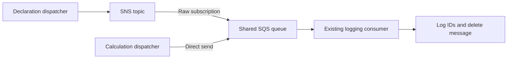

# Analytics events

The service uses one SNS topic and one subscribed SQS queue. Compliance declaration events are published to the topic and delivered to the queue through its raw-message subscription; calculation events are written directly to that same queue. One logging consumer reads both types. Both publishing paths use the same envelope, vocabulary validation and delivery guarantees described here. Entity-specific identities, event types, actors, correlation and payload schemas are described in each entity's page:

- [Compliance declaration events](analytics-compliance-declaration-events.md)
- [Obligation calculation events](analytics-obligation-calculation-events.md)

## Capture and delivery

An entity change and its analytics outbox event are written in the same Mongo transaction, so a failed write leaves no event. The [analytics processor](../src/AuditEvents/Analytics/AnalyticsAuditEventProcessor.cs) reads eligible undispatched events, serialises them, publishes them to its configured destination and records the dispatch outcome only after the destination accepts the message, applying its retry, lease and dead-letter behaviour. The [end-to-end event flow](compliance-declaration-end-to-end-event-flow.md) shows this path for compliance declarations.

Delivery is at least once: publication can succeed before the dispatch outcome is recorded, so a message can be repeated with the same `eventId`. Consumers must make ingestion idempotent using `eventId`.

## Message transport

Messages are published with the message attribute `Content-Type` set to `application/json`.

If the JSON body is too large for the destination's message size budget, the body is gzip-compressed and base64-encoded. The budget leaves 4 KiB for attributes within each service limit: 252 KiB for the SNS topic and 1020 KiB for a direct SQS queue. A message still over budget after compression is not sent and its dispatch is recorded as failed. Compressed messages include the message attribute `Content-Encoding` set to `gzip+base64`.

## Analytics event envelope

All analytics events use this generic envelope:

```json
{
  "eventId": "01JZ8RXBMTY2K15SJB3PCFN3D5",
  "sequence": 123,
  "entity": "entity_name",
  "entityId": "entity_name_entity-id",
  "operation": "create",
  "eventType": "domain.event",
  "deletedReason": null,
  "piiKeyRef": null,
  "occurredAt": "2026-01-02T03:04:05.000Z",
  "recordedAt": "2026-01-02T03:04:06.000Z",
  "actor": "user:e72be574-8b5b-4836-af47-dd7e0c0d1d87",
  "correlationId": "cdp-request-id",
  "version": 1,
  "before": null,
  "after": {},
  "schemaVersion": "entity_name_v1.0"
}
```

| Field | Description |
| --- | --- |
| `eventId` | ULID generated for the analytics event. |
| `sequence` | Global analytics event sequence allocated when the event is written. |
| `entity` | Logical entity type for the payload. |
| `entityId` | Unique identifier for the entity instance, with an entity-specific prefix. |
| `operation` | Event operation. See the operation values below. |
| `eventType` | Business event name registered for the entity. |
| `deletedReason` | Reason the entity was deleted. This is only set when `operation` is `delete`; otherwise it is `null`. |
| `piiKeyRef` | Always `null`; PII classification and protection are outside the scope of this change. |
| `occurredAt` | Time the entity change occurred, as a UTC ISO 8601 timestamp with millisecond precision. |
| `recordedAt` | Time the analytics event was recorded, as a UTC ISO 8601 timestamp with millisecond precision. |
| `actor` | Who or what made the change, as `<prefix>:<identifier>`. |
| `correlationId` | Correlation ID for the request or run that made the change; omitted when none is available. |
| `version` | Entity version after the operation. |
| `before` | Previous entity state. This is `null` for creates. |
| `after` | New entity state. This is `null` for deletes. |
| `schemaVersion` | Entity-qualified schema version, `<entity>_<version>`, for the `before` and `after` payloads. |

## Operation values

| Operation | Meaning | `before` | `after` | `deletedReason` |
| --- | --- | --- | --- | --- |
| `create` | Entity was created. | `null` | Created entity state. | `null` |
| `update` | Entity was changed. | Previous entity state. | Updated entity state. | `null` |
| `delete` | Entity was deleted. | Previous entity state. | `null` | Delete reason. |

## Controlled vocabulary

The publisher validates each event against the [analytics vocabulary](../src/AuditEvents/Analytics/AnalyticsEventVocabulary.cs) before serialising it. Each entity registers its entity ID prefix, permitted operations, event types and raw schema versions; an event whose entity, operation, event type, actor prefix, deletion reason or schema version is not registered cannot be published.

Actor prefixes are `service`, `user`, `system`, and `integration`. The only current deletion reason is `elevated_system_allowed_removal`. This replaces the legacy free-text value `elevated system allowed removal`, which remains normalised for undispatched historical outbox events. The governed list maintained with the shared event schema must include every registered value before it is published.

## Dispatch routing

Each dispatcher opts in to the entity values in its `IncludedEntities` configuration. The analytics topic dispatcher includes `compliance_declaration`; the calculation queue dispatcher includes `obligation_calculation`. An enabled dispatcher requires a non-empty list of registered entities; an empty or unknown list prevents startup. Filtering happens before the batch limit, and excluded events are not marked as dispatched.

The calculation dispatcher sends directly to the topic-subscribed queue using the same JSON envelope and content attributes as the topic publisher. The existing logging consumer reads both declaration and calculation messages from this queue, logs their event and entity IDs, and deletes each successfully decoded message. It may log a repeated event ID again; an ingesting consumer must handle duplicates. The two dispatchers retain distinct stable process names, leases and dispatch state even though their messages arrive at the same queue. Changing a process name causes retained events to be eligible again. Adding an entity to a dispatcher can send its retained backlog: decide the replay policy before changing the list. Delivery is at least once, so consumers must deduplicate by `eventId`.



During a mixed-version deployment, the previous dispatcher reads calculation audit events because it does not filter by entity, but rejects them during vocabulary validation before any SNS send. It records failed `analytics` dispatch attempts that can become dead-lettered. Those records are separate from the `calculation` queue dispatch state and do not prevent the new dispatcher from sending the event. Coordinate calculation activation with draining old instances to avoid these failed or dead-lettered analytics dispatch records.

Dispatch indexes include the configured process names `analytics` and `calculation`. Changing a process name requires an index migration as well as a replay decision. Migration 023 creates the entity-aware dispatch indexes before removing the two superseded `analytics` dispatch indexes from migration 002. Sequence, entity-history and admin-read indexes are retained. Rolling migration 023 back restores the original dispatch indexes before dropping their replacements.

Provision one topic with one SQS subscription using raw message delivery. Configure `AnalyticsAuditEventProcessor__TopicArn` with the topic ARN, and set both `CalculationAuditEventProcessor__QueueUrl` and `AnalyticsAuditEventConsumer__QueueUrl` to its subscribed queue URL. Retain the queue policy allowing that SNS topic to send messages; also grant the service identity `sqs:SendMessage` for direct calculation writes and receive/delete permissions for the logging consumer. Enable the topic dispatcher, calculation dispatcher and shared consumer with their respective `ProcessingEnabled` flags. They default to disabled; enabling dispatch later publishes eligible retained events. Deployment configuration and permissions are managed outside this repository; local Compose provisions the single topic and subscribed queue. No separate calculation queue or consumer is required.
