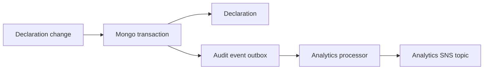
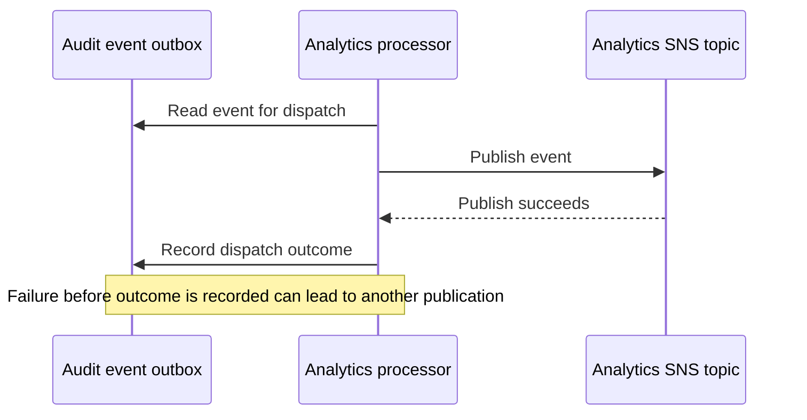

# Compliance declaration end-to-end event flow

This page follows a mutating compliance declaration request from the API write, through audit event recording, to the analytics SNS publish. The final analytics message contract is documented in [Analytics compliance declaration events](analytics-compliance-declaration-events.md).

The service uses two audit concepts:

- The compliance declaration document has an embedded `audit` array. This is the business history of status actions on the declaration.
- The `AuditEvent` collection is an outbox. It records publishable entity changes so a background processor can write analytics events after the API transaction commits.

## Transaction boundary

Declaration changes and their outbox events commit in the same Mongo transaction. A failed transaction commits neither; after commit, analytics publication happens asynchronously. The embedded declaration audit history and the publishable outbox event serve different purposes and must not be treated as interchangeable. See [transactional analytics outbox](adr/0008-transactional-analytics-outbox.md) for the decision and its rationale.

The declaration and outbox writes share the transaction; publication happens after commit. The [declaration service](../src/Api/Services/ComplianceDeclarationService.cs), [audit event service](../src/AuditEvents/AuditEventService.cs), and [analytics processor](../src/AuditEvents/Analytics/AnalyticsAuditEventProcessor.cs) define the current implementation.

## Mutation and outbox implementation

The [declaration service](../src/Api/Services/ComplianceDeclarationService.cs) and [audit event service](../src/AuditEvents/AuditEventService.cs) implement the transaction and optimistic concurrency. The [declaration entity](../src/Api/Data/Entities/ComplianceDeclaration.cs) owns business status history. Email delivery is outside the transaction; see the [email delivery cutover](email-delivery-cutover.md) for its cross-service activation and recovery constraints.

### Entity version and schema version

`version` is the concurrency version; `schemaVersion` identifies the persisted and analytics payload shape. A current declaration uses raw version `v1.3`, published as `compliance_declaration_v1.3` using the [v1.3 schema](../src/Api/Schemas/ComplianceDeclaration/compliance-declaration.v1.3.schema.json). See the [schema changelog](../src/Api/Schemas/ComplianceDeclaration/CHANGELOG.md) for contract history and migration compatibility.

Older embedded schemas remain available because historical audit snapshots retain their recorded version. For example, a v1.0 event remains v1.0 after a live declaration is migrated to v1.1. The [serializer](../src/AuditEvents/Analytics/JsonAnalyticsEventSerializer.cs) uses the event's version; migrations and corrections must not rewrite historical events. The [application data correction](application-data-corrections.md) explains the operational impact of the coverage correction, and the [calculator](../src/Api/Data/Entities/ObligationCoveragePercentageCalculator.cs) defines current coverage behaviour.

## Analytics event dispatch

The [processor](../src/AuditEvents/Analytics/AnalyticsAuditEventProcessor.cs), [mapper](../src/AuditEvents/Analytics/AnalyticsEventMappers.cs), [sender](../src/AuditEvents/Analytics/SnsAnalyticsEventSender.cs) and [processor options](../src/AuditEvents/Analytics/AnalyticsAuditEventProcessorOptions.cs) define dispatch, retry, message encoding and configuration. The [analytics guide](analytics-compliance-declaration-events.md) describes the consumer-facing contract and examples.

Delivery is at least once: publication can succeed before the dispatch outcome is recorded, so downstream consumers should use `eventId` or `sequence` to make ingestion idempotent. The optional [analytics consumer](../src/Api/Consumers/AnalyticsAuditEventConsumer.cs) is downstream of publication and is not required for audit capture or SNS publishing.
